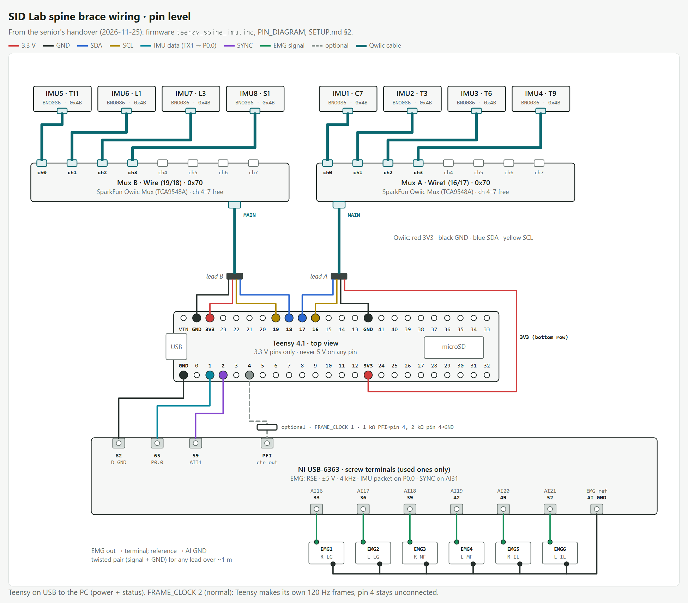

# IMU DAQ — IMU + EMG acquisition with DAQ time sync

Two BNO085/BNO086 IMUs on a XIAO ESP32S3 (or ESP32C3) and 8 EMG channels on an NI USB-6363, recorded
from one browser GUI. Every IMU frame is time-locked to the DAQ by a SYNC pulse wire, so IMU and EMG
share one time base (≈ 14 µs).

```
 XIAO ESP32S3 ── I2C ── BNO085 A4B (0x4B) ── STEMMA QT ── BNO085 A4A (0x4A)
   │ USB (frames)        │ SYNC pulse per frame (D1 → AI0)
   ▼                     ▼
 PC: host/server.py ◄── NI USB-6363 (AI0 = SYNC, AI16–23 = EMG01–08)
   │ HTTP + live stream
   ▼
 Browser GUI  http://127.0.0.1:8765
```

## Install (Windows)

1. **Get the code:** `git clone https://github.com/Juno31/imu-daq.git` (or *Code → Download ZIP*).
2. **Python packages:** double-click **`setup.bat`**. It creates the conda env `daq` from
   `environment.yml`, or without conda a `.venv` from `requirements.txt` (numpy, pandas, pyserial, nidaqmx).
3. **NI-DAQmx driver:** install *NI-DAQmx* from ni.com (tested 26.8). The DAQ must show in **NI MAX**.
   A USB-6363 needs its **power adapter switched on**; USB alone does not power it.
4. **Firmware** (once per board), Arduino IDE 2:
   - Boards Manager: **esp32 by Espressif** (tested 3.3.5). Board *XIAO_ESP32S3*, USB Mode
     *Hardware CDC and JTAG* (or *XIAO_ESP32C3*).
   - Library Manager: **SparkFun BNO080 Cortex Based IMU** (tested 1.1.12).
   - Open `firmware/imu_daq/imu_daq.ino` → Upload.

   Or with arduino-cli:
   ```
   arduino-cli core install esp32:esp32
   arduino-cli lib install "SparkFun BNO080 Cortex Based IMU"
   arduino-cli compile --upload -p COM4 --fqbn esp32:esp32:XIAO_ESP32S3:USBMode=hwcdc firmware/imu_daq
   ```
   **Teensy 4.1 (7 IMUs):** Boards Manager URL `https://www.pjrc.com/teensy/package_teensy_index.json`,
   install **Teensy** (tested 1.62.0), board *Teensy 4.1*, USB Type *Serial*. No library to install: the
   [teensy4_i2c](https://github.com/Richard-Gemmell/teensy4_i2c) driver is vendored in the sketch's `src/`.
   Upload `firmware/imu_daq_teensy/imu_daq_teensy.ino`; the GUI finds the Teensy by itself.
   Bench sketches for the Stage 1 wiring checks are in `firmware/bench/` (`i2c_map`, `imu7_bringup`).
5. Optional desktop shortcut: right-click `make_shortcut.ps1` → *Run with PowerShell*.

## Use

1. Plug in the XIAO and the DAQ. Close the Arduino Serial Monitor (it blocks the COM port).
2. Double-click **`start.bat`** (or the **IMU DAQ** shortcut). The browser opens the GUI.
   Only one server can run: a second launch just opens the browser. To restart, **close the black server
   window first**.
3. **Setup** (once per participant): check the four status lights are green, enter test date, subject and
   height, do the **static calibration** (still hold `C`, then forward bend `B`), and measure the
   **EMG normalization** (rest baseline and MVC / RVC) on the EMG norm page.
4. **Record trials**: minimize the Setup block, pick the task and trial, press **Space** (or Start), and
   **Space** again to stop. A banner reports frames, missing frames and **SYNC PASS / FAIL**.

Closing the browser does not stop a recording; closing the server window does (it saves first).

### The GUI

All pages open in the same browser tab and share one live-data connection, so several tabs can stay open.

**Experiment workflow** (step bar at the top of every page):

| Step | Page | What you do |
|---|---|---|
| 1 · Session | `/#session` | test date, subject ID, start / end time, protocol, IRB no., location, weather and indoor climate, team names and roles, notes → `session_info.json` |
| 2 · Participant | `/#participant` | age, sex, height, weight (BMI), dominant side, group, back pain, consent and eligibility → `participant.json` |
| 3a · IMU jig | `/#equip-jig` | all IMUs in the jig with one orientation: averaged quaternion per IMU, tilt and heading vs the reference IMU → `jig_alignment.json`; optional 6-face sensor calibration (records task `jigcal`, runs `jig_calibration.py`) |
| 3b · IMU attach | `/#equip-imu` | attachment checklist per IMU with live status, static calibration (still hold + forward bend) |
| 3c · EMG attach | `/#equip-emg` | skin prep / electrode checklist per channel, live RMS, 5 s rest-noise measurement → `setup_check.json` |
| 3d · DAQ & sync | `/#equip-daq` | device tiles, time sync test (short `synctest` recording, PASS when every frame has one SYNC pulse), Sync detail |
| 4 · MVC / RVC | `/emg` | EMG normalization (below) |
| 5 · Task recording | `/#record` | task trials, live signals, spine view, saved recordings |
| 6 · Data review | `/review` | finished recordings |

The info files are saved in `data/<date>/<subject>/` and copied into every trial recorded afterwards.
A step shows ✓ when it is done for the current date and subject.

**Main page** (`/`)

| Part | What it shows |
|---|---|
| **Setup** (steps 1–3) | One block, minimizable to a one-line summary with a READY / n of 3 DONE pill. Each step can also be minimized on its own. |
| 1 · System check | DAQ · IMU · EMG · Sync lights (green / yellow / red); click a tile for detail |
| 2 · Participant | test date, subject, height (scales the spine model, saved with each trial), notes |
| 3 · Static calibration | a · still hold (per-IMU table: moved, tilt, gyro bias, mag cal), b · forward bend (body axes for spine angles) |
| **Record trials** (step 4) | task and trial, output path, Start/Stop, marker, frame / missing / marker counters |
| **Live signals** | IMU (3D board, roll/pitch/yaw, plots), EMG (2 s envelope, 100 ms RMS, clipping), Sync detail, Event log |
| **Spine** (left, wide screens) | calibrated 3D spine model with view, ribs, trail and lumbar-share controls; blurred until the static calibration is done |
| **Saved recordings** (right) | latest recordings with SYNC result and size; click for files, click a file to open it |
| **⚙ Settings** | DAQ device/channels/rate/range, board port, IMU rate, orientation mode, clock statistics |

**Other pages** (links in the top bar)

| Page | Use |
|---|---|
| **EMG norm** (`/emg`) | Records rest, MVC and RVC captures (short recordings, editable trial number) and shows them as the main view: live 8-channel scope, or a saved capture with raw signal, 100 ms RMS, the analysed window and the reference line. Computes per channel offset, noise, MVC (highest 500 ms RMS, 20–450 Hz) and RVC; **Save** writes `<date>/<subject>/emg_norm.json`, copied into every later trial. |
| **Review** (`/review`) | Opens a finished recording: playback timeline, spine model replay, spine and IMU angles, EMG raw / RMS / **%MVC**. EMG norm captures show EMG only. |
| **Spine view** (`/spine`) | Full spine view: sensor placement, calibration, model options, angles |

The spine calibration (neutral pose, body axes, height) is kept by the server (`data/spine_cal_last.json`)
and shared by all pages; a page that is out of date cannot clear the forward-bend axis.
Sections open and close by clicking their header; the browser remembers the layout.
While not recording the DAQ runs a **preview** (nothing saved) so the DAQ/EMG lights and EMG traces work
before Start; turn it off with **Preview** in the EMG section if another program needs the DAQ.

### Keyboard shortcuts (press `?` in the GUI)

| Key | Action |
|---|---|
| `Space` | Start / stop recording (a second press within 1 s is ignored) |
| `M` | Event marker (uses the marker text) |
| `Z` | Zero the IMU display (recorded data unchanged) |
| `C` · `B` | Static calibration: still hold · forward bend |
| `1` `2` `3` `4` | Open / close IMU · EMG · Sync detail · Event log |
| `S` | Settings |
| `Esc` | Leave a text field (keys are off while typing) · close panels · stop an EMG capture early |
| `Enter` | On a step header: minimize / expand it |

## Hardware

| XIAO pin | S3 | C3 | to |
|---|---|---|---|
| 3V3 | | | IMU #1 VIN (never 5 V) |
| GND | | | IMU #1 GND, DAQ AI 8 (AI0−) |
| D4 SDA | GPIO5 | GPIO6 | IMU #1 SDA |
| D5 SCL | GPIO6 | GPIO7 | IMU #1 SCL |
| SYNC | D1 GPIO2 | D2 GPIO4 | DAQ AI 0 (AI0+) |

IMU #2 is chained from IMU #1 with a STEMMA QT / Qwiic cable. Addresses: the IMU wired to the XIAO is
**0x4B** (pod `A4B`), the chained one **0x4A** (pod `A4A`).
Adafruit BNO085: default 0x4A; DI soldered to 3Vo → 0x4B (read only at power-up).
SparkFun BNO086: default 0x4B; ADR jumper closed → 0x4A.

**EMG** (differential, Input = Differential): channel `aiN` uses pins AI N (+) and AI N+8 (−).

| Channel | Name | Muscle | Side |
|---|---|---|---|
| ai16 / ai17 | EMG01 / EMG02 | Lumbar erector spinae | L / R |
| ai18 / ai19 | EMG03 / EMG04 | Lumbar multifidus region | L / R |
| ai20 / ai21 | EMG05 / EMG06 | External oblique | L / R |
| ai22 / ai23 | EMG07 / EMG08 | Internal oblique | L / R |

Edit `host/channels.py` to change the map.

**Unconnected EMG inputs copy SYNC.** The USB-6363 measures its channels one after another with one
converter. An input with nothing connected cannot drive it, so it repeats the channel scanned just
before it: during recording, the SYNC pulses appear on every open EMG input at 30–98 % of their height
(about 0.9 V RMS). Measured on this DAQ: a connected, low-impedance source (like an EMG amplifier output)
picks up only ~13 µV (0.0004 %), so real EMG is not affected. The GUI marks such channels **NOT CONNECTED**
(EMG light, EMG traces, calibration result) whenever a channel correlates with SYNC (r > 0.5). Connect the
amplifier outputs, or remove unused channels in Settings → EMG / extra channels.

### Planned wiring: Teensy 4.1, 7 IMUs, 3 GoPros

Next hardware revision (not built yet): a Teensy 4.1 with an Ethernet kit streams 7 IMUs to the PC over
UDP, keeps the SYNC pulse to the USB-6363, and three GoPro HERO13 cameras connect through a powered USB 3 hub.
The IMUs sit on two TCA9548A muxes on two separate I2C buses: mux A on `Wire` (pins 18/19, IMUs 1–4) and
mux B on `Wire1` (pins 17/16, IMUs 5–7). The two buses are read in parallel; a timing simulation gave
200 frames/s with a worst frame of 4.7 of 5 ms, while one bus overran even at 100 frames/s.
Firmware `firmware/imu_daq_teensy` (v2.0) implements this over USB serial for bench tests, with the same
line protocol as the XIAO firmware; it reports each bus's time per frame in `status` and in `summary.json`
(`i2c_buses`). The Ethernet/UDP link replaces USB later.

Optional DAQ clock (v2.1): wire the DAQ counter output (PFI 12 by default on the USB-6363) to Teensy pin 4
and D GND to GND. Then the command `clock ext` (or `"board_clock": "ext"` in `host/host_settings.json`)
starts one frame per rising edge instead of using the Teensy timer. SYNC on pin 2 stays as it is. Pin 4 takes
3.3 V at most, so a 5 V counter output needs a divider (1 kΩ series, 2 kΩ to GND). `status` prints
`@CLOCK` (edges, period, glitches), and the board reports `clock_lost` / `clock_ok` events.



## How it works

**Firmware** (`firmware/imu_daq/imu_daq.ino`):
- A hardware timer ticks every frame (100 Hz default; 200/50/25 Hz selectable) and snapshots the newest
  quaternion of each IMU, so I2C work never affects timing (10.000 ± 0.002 ms at 100 Hz).
- **Idle:** preview frames, no SYNC pulses. **Recording:** frame counter restarts at 0 and each frame gets
  one SYNC pulse, **3 ms for frame 0**, 1 ms for all others.
- IMUs report ~10 % faster than the frame rate (≈ 100 % new data); a silent IMU is restarted after 0.5 s.
- USB output never blocks; frames queue (512) if the PC is briefly slow.
- **v1.2 sensors per IMU:** quaternion (game rotation vector), accelerometer [m/s², incl. gravity],
  gyroscope [rad/s] and magnetometer [µT]. Each frame carries the newest value of each, plus a flag for
  whether it is new. Measured with 2 IMUs on one I2C bus:

  | Frame rate | quaternion | accelerometer | gyroscope | magnetometer |
  |---|---|---|---|---|
  | **100 Hz** (recommended) | 100 Hz | ~95 Hz | 100 Hz | ~66 Hz |
  | 200 Hz | ~69 Hz | ~78 Hz | ~95 Hz | ~43 Hz (I2C bus is full) |

  Use 100 Hz when you need all sensors. `mag_acc` (0–3) is the magnetometer calibration state: move each
  IMU in a figure-8 until it reaches 2–3.

**Host** (`host/`):

| File | Role |
|---|---|
| `server.py` | state machine, start/stop sequence, HTTP API + live stream, DAQ preview, single instance |
| `device.py` | serial reader thread, line parser, 64-bit board clock |
| `daq.py` | NI-DAQmx reader thread, raw file, SYNC edge detection, 2 s live buffer, `align()` |
| `syncmon.py` | live pulse↔frame matching for the Sync detail view |
| `clocksync.py` | board↔PC clock fit from 1 Hz ping/pong (fastest third of pings) |
| `session.py` | session folder and files |
| `channels.py` | EMG channel map |
| `spine_angles.py`, `static/spine.*` | Spine view |
| `static/index.html, app.js, app.css` | GUI (plain canvas, no libraries) |

**Start:** session folder → DAQ starts first → board `start` (frame 0 + 3 ms pulse).
**Stop:** board `stop` (queued frames sent) → DAQ stops → pulses matched to frames → files written.

### Time sync

| Column (`imu_synced.csv`) | Meaning | Accuracy |
|---|---|---|
| `t_us` | XIAO clock at the frame's SYNC rising edge | µs (board clock) |
| `daq_time_s` | DAQ time of that edge (s from the DAQ's first sample) | 1 sample: 50 µs at 20 kHz (SD ≈ 14 µs) |
| `pc_unix_s` | PC wall-clock time from the ping fit | ≈ ±0.5 ms |

At Stop the server finds the wide frame-0 pulse and numbers each later pulse by its spacing to the
previous one (a lost pulse leaves one gap, it does not shift later frames). **SYNC PASS** = every frame
has exactly one pulse. EMG is sampled on the same DAQ clock, so `daq_time_s` lines it up with the IMU.

The DAQ default rate is **20 kHz**: edge timing SD ≈ 14 µs (vs 29 µs at 10 kHz), pulses clearly resolved
(1 ms = 20 samples), ample for EMG; 9 channels = 180 kS/s, well within the USB-6363.

## Session folder (`data/<date>/<subject>/<subject>_<task>_trial<NN>/`, not in git)

A repeat of an existing trial number is saved as `…_trial<NN>_2`; nothing is overwritten.

| File | Content |
|---|---|
| `imu_synced.csv` | **main file**: IMU frames + `pc_unix_s` + `daq_time_s` |
| `imu.csv` | raw frames: frame, t_us, per IMU ok, fresh, w, x, y, z; then per IMU acc_new, gyr_new, mag_new, ax, ay, az [m/s²], gx, gy, gz [rad/s], mx, my, mz [µT], mag_acc |
| `daq_raw.f32`, `daq_meta.json` | DAQ samples float32, sample-major (n × channels); channels, labels, rate |
| `daq_pulses.csv` | every SYNC pulse (rise, width) |
| `events.csv` | start/stop, markers, IMU stalls/restarts, warnings |
| `clock_sync.csv` | every ping used for the PC clock fit |
| `session.json` | subject, trial, notes, firmware, DAQ settings |
| `summary.json` | quality report: rate, missing frames, % new data, clock fit, SYNC check |
| `spine_cal.json` | spine calibration used (neutral quaternions, body axes, sensor map, height) |
| `calibration.json` | static calibration used (still hold results) |
| `emg_norm.json` | EMG normalization used (offset, noise, MVC / RVC per channel), if made |
| `session_info.json`, `participant.json`, `jig_alignment.json`, `setup_check.json` | experiment information from steps 1–3, if saved |

Read the DAQ file in Python:
```python
import json, numpy as np
m = json.load(open("daq_meta.json"))
x = np.fromfile("daq_raw.f32", dtype=np.float32).reshape(-1, len(m["channels"]))
t = np.arange(len(x)) / m["rate_hz"]               # same time base as daq_time_s
emg01 = x[:, m["channels"].index("ai16")]          # names in m["channel_labels"]
```

## Serial protocol (for other tools)

Board → PC: `P,seq,t_us,...` (preview), `F,frame,t_us,...` (recorded), `@HELLO`, `@START`, `@STOP`,
`@PONG`, `@EVENT`, `@STATUS`, `@POD`, `@RATE`, `@ACK`, `@ERR`, `# comments`.
PC → board: `hello`, `start`, `stop`, `ping <token>`, `status`, `restart`, `rate <5|10|20|40>`.
Details at the top of `imu_daq.ino`.

## Troubleshooting

| Symptom | Fix |
|---|---|
| "Server not running" banner | Start `start.bat`; check its window for an error |
| Changes not showing after an update | Close the old server window, then start again; F5 in the browser |
| "COMx is in use by another program" | Close the Arduino Serial Monitor / other viewers; the server retries every 2 s |
| "no @HELLO from the board" | Upload `firmware/imu_daq` (older sketches use a different protocol) |
| IMU light red / NOT FOUND | Check the cable; for 0x4B on an Adafruit board check the DI–3Vo solder, then replug USB |
| DAQ light "Not found" | Power adapter + switch on the USB-6363, check NI MAX, then Refresh in Settings |
| EMG "Clipping" | Raise Range to ±10 V or lower the amplifier gain |
| A page keeps loading | Reload; all pages share one connection now. If it persists, close other IMU DAQ tabs |
| EMG norm "NOT DONE" | Record rest and MVC / RVC on the EMG norm page, then **Save for this subject** |
| SYNC FAIL | Check AI0+/AI0− wiring and Input = Differential; see `daq_pulses.csv`, `summary.json` |

Note: unconnected EMG inputs still read ~1.5–2 mV RMS, so a flat-signal check cannot detect a missing
electrode; check that the trace rises when the muscle contracts.

Command line: `python host/server.py --help` (web port, data folder, fixed serial port, no browser).
